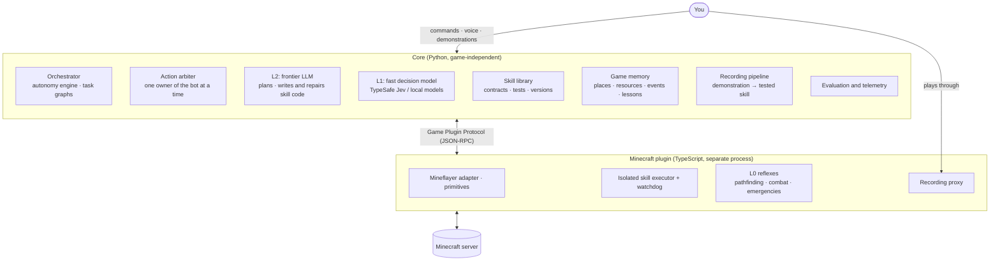

# minecraft-agent

**A bot that learns to play games by playing them, and by watching you play.**
It writes its own skills as code, tests them, keeps the ones that work, and gets faster over time.
Minecraft is the first game; the core is game-independent and every game is a plugin.


> **Project status:** the research and design are complete and the coding phase has started.
> Nothing below is runnable yet; setup instructions will appear here as the code lands.
> Delivery date: **2026-11-19**. Progress is tracked in [`docs/plan.md`](docs/plan.md).

---

## What it does

- **Learns by playing.** Like [Voyager](https://github.com/MineDojo/Voyager), the bot proposes its own next task, has an LLM write a skill for it, runs the skill in the game, verifies the result, and stores successful skills in a library it reuses later.
- **Learns from you.** Play a task once while narrating (by voice or with `//` notes in chat). The bot turns the demonstration into a parameterized skill and tests it in fresh worlds before keeping it.
- **Works while you are away.** "Mine 64 iron, empty the inventory at home when it is full, sleep at night, run home if health drops below 6, stop after 2 hours." Commands can be typed, spoken, or built as a pipeline.
- **Remembers the world.** Home, portals, villages, chests and mines are stored as structured records, so it never walks back to a mine it has already exhausted.
- **Decides on its own.** In full-autonomy mode it never stops to ask; it picks the most plausible interpretation, logs its assumptions and reports back. Less autonomous modes ask with a timeout and never block.
- **Has a personality, optionally.** A mood that reacts to events, short narration and an end-of-day diary, bounded so it never gets in the way of the task.

## How it works



Every decision is made by the fastest layer that is good enough:

| Layer | Who | Speed | Used for |
|---|---|---|---|
| **L0** | Plain code | ≤ 100 ms | Pathfinding, aiming, distances, emergency reactions, success checks |
| **L1** | [TypeSafe Jev](https://docs.typesafe.ai) or a local decision model | p95 ≤ 300 ms | Small typed choices: which tactic, which skill, what did the player mean |
| **L2** | Claude Sonnet 5.5 (Haiku 5.5 for high-volume text) | seconds | Writing and repairing skill code, planning, turning demonstrations into skills |
| **L3** | Offline | minutes–hours | Labeling data, fine-tuning local decision models, library maintenance |

Key design choices, each explained in [`docs/research.md`](docs/research.md):

- **Skills are code with contracts.** Every skill declares its parameters, preconditions, side effects and a success predicate written *before* the code and *independently* of it. Skills earn trust through tests: draft → verified → trusted.
- **A general `obtain(item, n)` solver** walks Minecraft's recipe graph in code, replacing hundreds of LLM-written "craft X" skills.
- **LLM-written code never runs in the bot's process.** It runs in an isolated executor without keys, behind a permission-checked primitive broker and an external watchdog.
- **Location questions are answered by code, not by RAG.** RAG is used only for free-text history ("why did we stop going east?").
- **The core never mentions a game.** A plugin provides the adapter, primitives, predicates, vocabulary and recorder. Doom is the next plugin.

## Evaluation

The main claim the project sets out to prove:

> **A learned skill library reduces time and LLM calls in worlds the bot has never seen, without lowering success.**

Targets (measured in a *fair visibility* mode where the bot only knows what it can see, always reported with confidence intervals):

| Target | Goal |
|---|---|
| Diamond pickaxe from an empty inventory, easy, unseen seeds | ≥ 8 / 10 seeds |
| 25-task test set (wood → stone → iron → diamond, armor, food, mobs) | ≥ 90 % success |
| Survive 3 in-game days on normal | ≤ 1 death |
| Emergency reaction / tactical decision | ≤ 100 ms / p95 ≤ 500 ms |
| Skills learned from demonstrations, replayed in fresh worlds | ≥ 4 / 5 |
| Stretch: Ender Dragon in an unknown world, survival, no prepared route | at least one verified run |

The full protocol (pre-registration, separate learning and test seeds, paired runs, ablations) is in [`docs/research.md` §11](docs/research.md).

## Roadmap

| Week | Ends | Goal |
|---|---|---|
| 1 | Oct 22 | The bot is up and safe: server, plugin protocol, isolated execution, action arbiter |
| 2 | Oct 29 | The first learning loop: LLM-written skills, skill library, evaluation runner |
| 3 | Nov 5 | Exploration, game memory, the L1 decision layer |
| 4 | Nov 12 | AFK commands, learning from demonstrations, main evaluation runs |
| 5 | Nov 19 | Evaluation report and demo |
| Later | | Doom plugin, multi-agent play |

Details, work items and status: [`docs/plan.md`](docs/plan.md).

## Getting started

Not playable yet; the Minecraft server and the first bot arrive with plan item P1.2. You will need:

- Python 3.13 and [uv](https://docs.astral.sh/uv/)
- Node.js 22
- Docker (the Minecraft server runs in a container)
- Minecraft Java Edition 1.21.11 (only to watch in-game or to teach the bot)
- API keys for Anthropic and, optionally, TypeSafe (see [`.env.example`](.env.example))

Check the core (Python):

```bash
cd core
uv sync
uv run ruff check && uv run pyright && uv run pytest
```

> The bot runs LLM-written code. Only connect it to your own local server, never to a public one.

## Documentation

| Document | What is in it |
|---|---|
| [`docs/plan.md`](docs/plan.md) | Implementation plan, week by week, with status |
| [`docs/research.md`](docs/research.md) | Research and design: Voyager and competitors, Jev, general game agents, record a skill, architecture, memory, skills, commands, personality, evaluation, risks |
| [`docs/reviews/`](docs/reviews/) | Independent design reviews by Claude Opus 5.5 and GPT-6-Astra |
| [`AGENTS.md`](AGENTS.md) | Decisions, module map, rules and workflow for contributors and coding agents |
| [`docs/notes.md`](docs/notes.md) | Notes and open questions |

## How this project is built

The code is written by an AI coding agent (Claude Code) and reviewed by the project owner, one small pull request at a time. Every PR explains what changed, how it was verified, and what to learn from it. The workflow is described in [`AGENTS.md`](AGENTS.md#workflow).

## Built on and inspired by

- [Voyager](https://github.com/MineDojo/Voyager): the curriculum + skill library + self-verification loop
- [Mindcraft](https://github.com/mindcraft-bots/mindcraft): parts of the Minecraft plugin are borrowed from it (MIT)
- [Mineflayer](https://github.com/PrismarineJS/mineflayer) and [node-minecraft-protocol](https://github.com/PrismarineJS/node-minecraft-protocol)
- [TypeSafe Jev](https://docs.typesafe.ai) and [rmalde/minecraft-agent](https://github.com/rmalde/minecraft-agent): a planner + fast decision model + Mineflayer
- Research cited throughout [`docs/research.md`](docs/research.md#sources)

## Context

An individual project for the Softito AI course ("A Learning Agent in Minecraft": Mineflayer + LLM, Voyager-like, skill library).

## License

[MIT](LICENSE). Parts borrowed from other MIT-licensed projects (such as Mindcraft) keep their original copyright notices.
